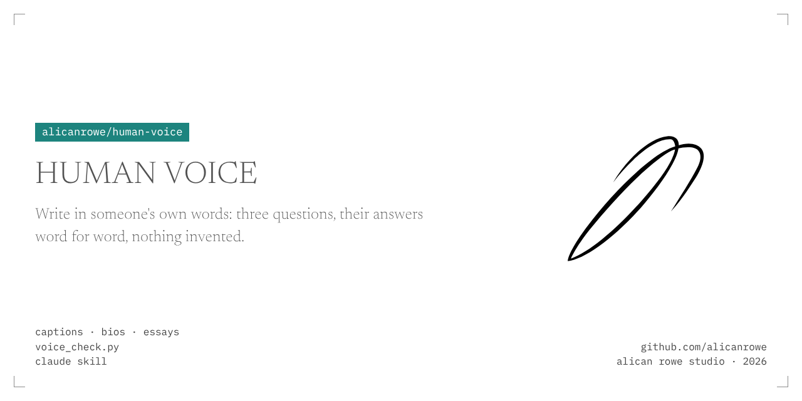

# Human voice skill

A Claude skill for writing in someone's own voice: captions, site copy, bios, emails and essays. Instead of
polishing style, it asks the person three questions and builds the text from their answers word for word, never
inventing a detail. A small checker (`scripts/voice_check.py`) flags em dashes, lists of three, "X for Y" swaps and
stock AI words.

See `SKILL.md` for the steps.
